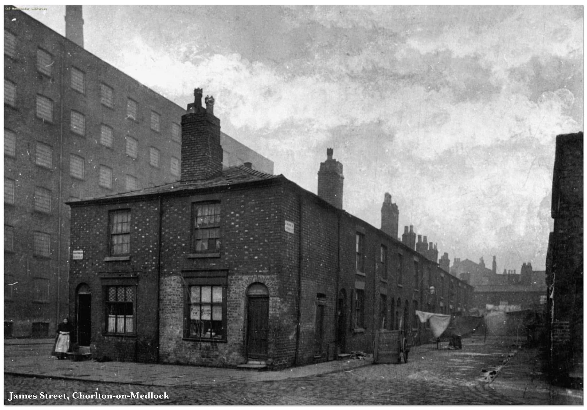
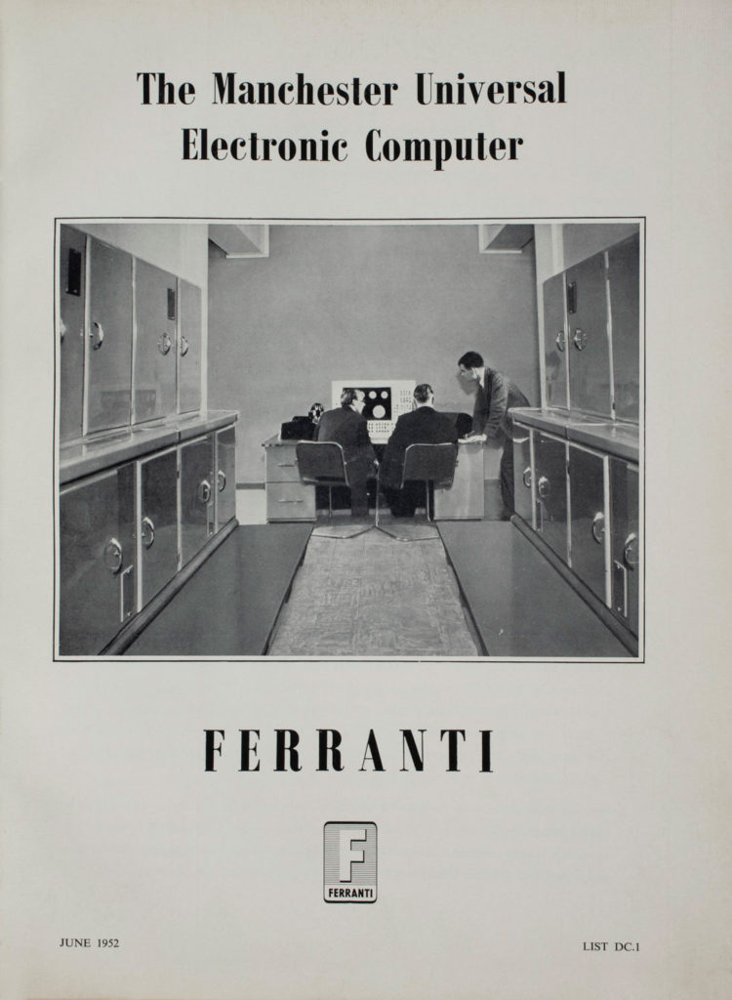

## Thursday, 9 June 1949 {.image-1}

::: {.photo .left}

:::

::: {.photo .right}

:::

## {.center-text}

"Not until a machine can write a sonnet or compose a concerto because of thoughts and emotions felt, and not by the chance fall of symbols, could we agree that machine equals brain -- that is, not only write it but know that it had written it...

Geoffrey Jefferson, Lister Oration, 9 June 1949

## {.center-text}

...No mechanism could feel (and not merely artificially signal, an easy contrivance) pleasure at its successes, grief when its valves fuse, be warmed by flattery, be made miserable by its mistakes, be charmed by sex, be angry or depressed when it cannot get what it wants."

Geoffrey Jefferson, Lister Oration, 9 June 1949

## {.center-text}

A sonnet written by a machine would probably be better appreciated by another machine.

Alan Turing, in <em>The Times</em>, 11 June 1949, "Calculus to Sonnet".

# Three women before her

## Little Ireland, 1840 {.image-copy}

::: {.photo}

:::

::: {.video}

:::
- Her great-grandmother, born in the Little Ireland at the bend of the Medlock
- Engels walked through in 1844

## Chadwick, 1842 {.image-copy .contain}

::: {.photo}

:::

::: {.note}
Script quotes the average-age-at-death table (17 / 20 / 38). Either swap the image or change the line.
:::

## The line of life {.forks-slide}

::: {.note}
1752 the infirmary, 1848 the Public Health Act, 1851 Longdendale water and Owens College: all paid for in rooms like this one. Dementia is a disease you have to be old enough to catch.
:::

# The first forks

## 1960: the eleven-plus {.forks-slide}

::: {.note}
[grammar school] / [secondary modern on street]; girls' pass rate in her ward [FIGURE]. Jefferson dies that winter.
:::

## {.center-text}

That time of year thou mayst in me behold When yellow leaves, or none, or few, do hang Upon those boughs which shake against the cold, Bare ruined choirs, where late the sweet birds sang.

Sonnet 73. She is fifteen. She can say all fourteen lines in forty seconds without breathing.

## 1965: Ferranti, Moston {.image-4}

Where she passed, she stays on at school. Where she did not, she goes to the assembly line at Ferranti, building the commercial version of the machine Jefferson and Turing argued over.

At the bus stop on Moston Lane she starts smoking. [FIGURE] per cent of women her age did.

::: {.photos}

:::

::: {.note}
Fourth image: placeholder (Getty clip 1B012359_0015 if licensed). Moston attribution unverified: check Lavington.
:::

## 1965 {.forks-slide}

# Who turns the wheel

## Four of her {.forks-slide}

::: {.note}
1999 blood pressure, 165 over 95, a knee. 1989 smoking, a husband's angina. 2009 hearing aids, a daughter's rota, Crumpsall.
:::

## {.center-text}

14

modifiable risk factors. Taken away, nearly half of all dementia.

Lancet Commission on dementia, 2024 [UNVERIFIED: figure and interval]

# Except here.

## 2026: twelve minutes {.forks-slide}

::: {.note}
"Probably just age, come back if it gets worse" versus referred that day. Left branch: 2029, CDR 2, no trial, the sonnet gone.
:::

## {.center-text}

The only time anything can be done about this disease is before the memory test fails. By the time a memory clinic sees you, the memory test has failed.

The traditional clinic is built back to front. So we built one the right way round.

## Before lunch {.team}

::: {.team-grid}
::: {.member}

### Alex Cook
Blood for pTau217: Alzheimer's disease in the brain years before a memory test fails.
:::
::: {.member}

### Nicola Kendall
Arterial stiffness and blood pressure, found and treated the same morning.
:::
::: {.member}

### Hala Shokr
The vessels at the back of the eye.
:::
::: {.member}

### Research-grade MRI
Before the afternoon.
:::
::: {.member}

### Lumbar puncture
More than two hundred so far.
:::
::: {.member}

### Same-day change
Nearly half leave with a change to blood pressure or statin [figure, if cleared].
:::
:::

## {.center-text}

Jefferson's condition for a mind was that it should know what it had done.

She knows what hers is doing.

## {.center-text}

1,000 people, 7 years

A pharmaceutical company's study of memory and blood vessels, placed in Manchester rather than Boston or Oxford, because Manchester can find the patients, scan them, bleed them and keep them.

# Four women, seventy-seven

## All of them are her {.forks-slide}

::: {.note}
68: a home in Blackley, she can still sing. 77: she knows what her brain is doing. 84: argues with the radio. 91: Sonnet 73 at the wedding, standing.
:::

## One pathology {.comparison}

:::: {.columns}
::: {.column}
- The same amyloid
- The same tangles
- The same silted arteries
:::
::: {.column}
- At sixty-eight: twenty-five years of a life
- At ninety-one: two
- The same disease, not the same event
:::
::::

# Which branch

## Where they live {.forks-slide}

::: {.note}
Incidence falling in England since the 1990s, in the top third by schooling or income and nowhere else [UNVERIFIED: CFAS, stratifier]. Chadwick's table re-run in 2018: Manchester still at the bottom. A gradient in the age at which the sonnet goes.
:::

## In this room

- [The other GJBRC groups: one sentence each, named person, one thing, one number.]

## The ask {.plain}

- [X]
- It costs [Y]
- It will move [N] women a year from the first branch toward the fourth
- I will come back to a Showcase in [year] and tell you what the number was

## {.center-text}

The infirmary, 1752. This university, 1851. The sewers that let her grandmother reach sixty-six.

All of it was paid for in rooms like this one.

## Thank you {.end}

But if the while I think on thee, dear friend,\
all losses are restored and sorrows end.

[Ross Dunne\
Geoffrey Jefferson Brain Research Centre]{.small}
