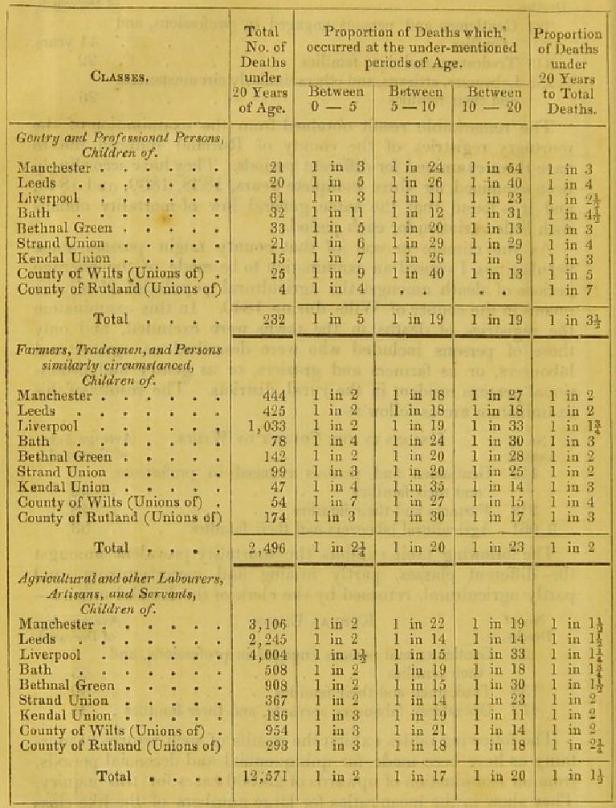

## {.stage view="1946-1954" grow="machine:1949.3 maisie:1949.7" lit="x1949" colours="false" ends="false"}

::: {.pin year=1949.44 side=below align=right}

Thursday, 9 June 1949. Maisie is born at home in Harpurhey, in a two-up two-down off Rochdale Road.
:::

## {.stage grow="machine:1949.7"}

::: {.pin year=1949.44 side=above width=wide align=right}
{height=170}

> "Not until a machine can write a sonnet or compose a concerto because of thoughts and emotions felt, and not by the chance fall of symbols, could we agree that machine equals brain, that is, not only write it but know that it had written it."

Geoffrey Jefferson, the Lister Oration, Royal College of Surgeons, the same afternoon
:::

## {.stage}

::: {.pin year=1949.44 side=above width=wide align=right}
> "No mechanism could feel (and not merely artificially signal, an easy contrivance) pleasure at its successes, grief when its valves fuse, be warmed by flattery, be made miserable by its mistakes, be charmed by sex, be angry or depressed when it cannot get what it wants."

Jefferson, the same oration
:::

## {.stage}

::: {.pin year=1949.45 side=below width=wide align=right}
{height=150}

> "A sonnet written by a machine would probably be better appreciated by another machine."

Alan Turing, The Times, Saturday 11 June 1949, "Calculus to Sonnet". Maisie was two days old.
:::

## {.stage}

::: {.pin year=1949.44 side=mid width=wide align=right}
> What is a brain, that it can feel its way to a sonnet, and know that it has done so?

The girl and the question began in the same week in the same city. We follow both for seventy-seven years.
:::

## Before her {.stage dim="true"}

::: {.cover}
:::: {.columns}
::: {.column width="40%"}

:::
::: {.column width="60%"}
### Chadwick, 1842

- Her great-grandmother: Little Ireland, the bend of the Medlock. Typhus at nineteen.
- Her grandmother, 1878: sixty-six.
- Her mother, 1915: eighty-one.
- Water from Longdendale, sewers under the streets, the infirmary, this university: paid for in rooms like this one.
:::
::::
:::

::: {.notes}
Table shown is deaths under twenty by class and town; the script's 17 / 20 / 38 are from the average-age table. Dementia is a disease you have to be old enough to catch.
:::

## {.stage view="1946-1964" grow="maisie:1960 machine:1962"}

::: {.pin year=1956 side=below}
Medicine saved the body, and the body lived long enough to lose the person it was carrying.

When she is two, the BBC puts Jefferson and Turing in a studio to argue about whether machines can think. Nobody on Rochdale Road is listening.
:::

## 1960: the eleven-plus {.stage view="1946-1972" grow="maisie:1963.5"}

::: {.pin year=1960 side=below}
{height=200}

One Manchester: the bus to [grammar school]. Another: the secondary modern on [street]. Girls' pass rate in her ward: [FIGURE].

That winter Jefferson dies, at seventy-four.
:::

## {.stage dim="true"}

::: {.cover}
> That time of year thou mayst in me behold When yellow leaves, or none, or few, do hang Upon those boughs which shake against the cold, Bare ruined choirs, where late the sweet birds sang.

Sonnet 73, for the O-level. She is fifteen. She can say all fourteen lines in forty seconds without breathing.
:::

## 1965: Ferranti, Moston {.stage view="1946-1975" grow="maisie:1972 machine:1966" lit="x1965 b84 b91"}

::: {.pin year=1965 side=below width=wide align=right}
{height=200}

Where she passed, she stays on at school. Where she did not, she goes to the assembly line at Ferranti and builds the commercial version of the machine Jefferson and Turing argued over. She never knows this.

At the bus stop on Moston Lane she starts smoking. [FIGURE] per cent of women her age did.
:::

::: {.notes}
Moston attribution unverified: check Lavington. Clip images/ferranti-soldering-getty.mp4 available if licensed.
:::

## Who turns the wheel {.stage view="1955-2015" grow="maisie:2014"}

::: {.pin year=1999 side=below width=wide align=right}
**1999, blood pressure.** 165 over 95, found because of a knee. One of her leaves with a prescription and a nurse who rings in March. One of her has no knee, and it sits for fifteen years doing to the small arteries of her brain what Adam Greenstein's laboratory now watches under a microscope.

**1989, smoking.** A husband's angina; they stop together. Or not.

**2009, hearing.** A daughter's rota, a morning at Crumpsall. Or the Tuesday club, given up, and a decade of the television getting louder.
:::

## {.stage dim="true"}

::: {.cover}
### 14

modifiable risk factors. Taken away, nearly half of all dementia.

Lancet Commission on dementia, 2024 [UNVERIFIED: figure and interval]. Every one of them is on her branches somewhere. None of these were heroic decisions and almost none were hers.
:::

## {.stage view="1955-2030" dim="true"}

::: {.cover tone=dark}
> I have no control over any of that.

I can vote, I can shout, I can lobby for the poor. Except here.
:::

## 2026: twelve minutes {.stage view="1985-2032" grow="maisie:2026 machine:2040" lit="x2026 b77 b68"}

::: {.pin year=2026 side=above width=wide align=left}
**One GP**, in a twelve-minute slot: probably just age, come back if it gets worse. She comes back in 2029 and fails a memory test that confirms what we could have told her three years earlier. CDR 2. No trial. The sonnet gone.

**The other GP** takes the repeated story seriously and refers her that day to the Brain Health Clinic, three miles from here.
:::

## {.stage lit="x2026 b77" dim="true"}

::: {.cover}
> The only time anything can be done about this disease is before the memory test fails. By the time a memory clinic sees you, the memory test has failed.

The traditional clinic is built back to front. So we built one the right way round.
:::

## Before lunch {.stage lit="x2026 b77" dim="true"}

::: {.cover}
:::: {.columns}
::: {.column width="33%"}
#### Alex Cook
Blood for pTau217: Alzheimer's disease in the brain years before a memory test fails.

#### Research-grade MRI
Before the afternoon.
:::
::: {.column width="33%"}
#### Nicola Kendall
Arterial stiffness and blood pressure, found and treated the same morning.

#### Lumbar puncture
More than two hundred so far.
:::
::: {.column width="33%"}
#### Hala Shokr
The vessels at the back of the eye.

#### Same-day change
Nearly half leave with a change to blood pressure or statin [figure, if cleared]. In a trial by the summer.
:::
::::
:::

## {.stage lit="x2026 b77"}

::: {.pin year=2026 side=below width=wide align=left}
> Jefferson's condition for a mind was that it should know what it had done. She knows what hers is doing.

For four generations nobody in that house off Rochdale Road lived long enough for their brains to betray them. Hers is the first to be looked at, measured, and reported back to its owner as something to take care of.
:::

## {.stage lit="x2026 b77" dim="true"}

::: {.cover}
### 1,000 people, 7 years

A pharmaceutical company's study of memory and blood vessels, placed in Manchester rather than Boston or Oxford.

Because Manchester can find the patients, scan them, bleed them and keep them.
:::

## Four women, seventy-seven {.stage view="1946-2045" grow="maisie:2040 machine:2040" colours="true" ends="true"}

::: {.pin year=1975 side=above width=wide}
All of them are her. All of them are alive in Manchester tonight.

**68**: a home in Blackley; she can still sing. **77**: she knows what her brain is doing. **84**: argues with the radio. **91**: Sonnet 73 at the wedding, standing.
:::

## {.stage dim="true"}

::: {.cover}
:::: {.columns}
::: {.column width="50%"}
### One pathology

- The same amyloid
- The same tangles
- The same silted arteries
:::
::: {.column width="50%"}
### Not the same event

- At sixty-eight: twenty-five years of a life
- At ninety-one: two
- That difference is the entire subject of this centre
:::
::::
:::

## Which branch {.stage}

::: {.pin year=1975 side=above width=wide}
Decided, mostly, before she could vote. Dementia incidence has fallen in England since the 1990s, in the top third by schooling or income and nowhere else [UNVERIFIED: CFAS, stratifier].

Chadwick's table re-run in 2018: Manchester still at the bottom. It is now a gradient in the age at which the sonnet goes.
:::

## {.stage dim="true"}

::: {.cover}
### In this room

- [The other GJBRC groups: one sentence each, named person, one thing, one number.]

### The ask

- [X]. It costs [Y]. It will move [N] women a year from the first branch toward the fourth.
- I will come back to a Showcase in [year] and tell you what the number was, whichever way it went.
:::

## {.stage lit="b91"}

::: {.pin year=2030 side=above width=wide align=left}
> The infirmary, 1752. This university, 1851. The sewers that let her grandmother reach sixty-six. All of it was paid for in rooms like this one.

On the branch I would like her to be on, she has fourteen more years with the sonnet.
:::

## Thank you {.end}

But if the while I think on thee, dear friend,\
all losses are restored and sorrows end.

[Ross A. Dunne\
Geoffrey Jefferson Brain Research Centre]{.small}
