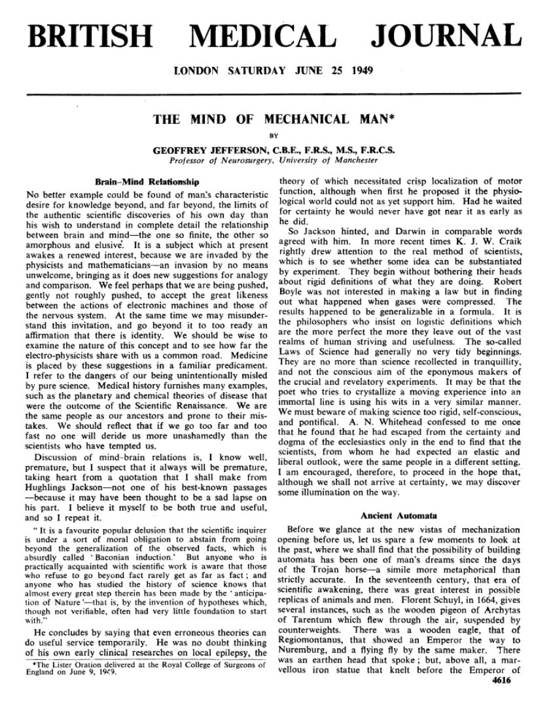
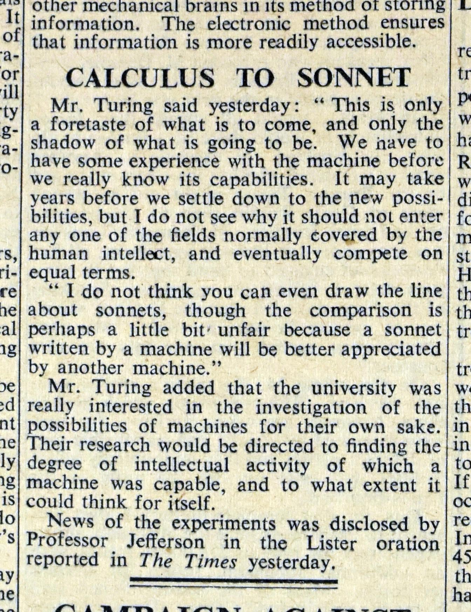
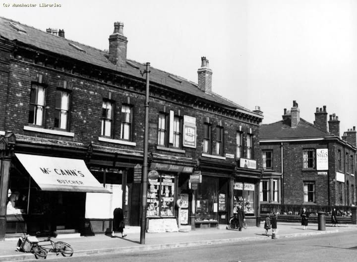
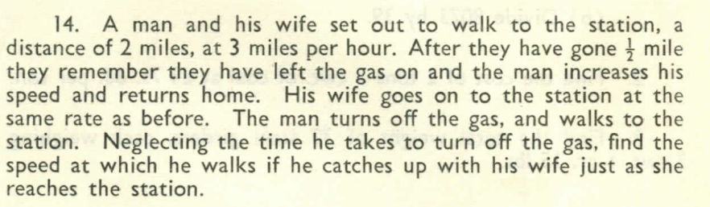
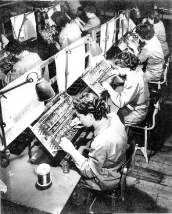

## {.stage view="1946-1954" grow="machine:1948.6" colours="false" ends="false"}

::: {.pin year=1948.47 side=mid align=right}
**21 June 1948.** In a room on Coupland Street, the Manchester Baby built by Freddie Williams and Tom Kilburn runs the first program ever held in electronic memory.  The newspapers call it an "electronic brain".
:::

## {.stage grow="machine:1949.3"}

::: {.pin year=1948.67 side=mid align=right}
**September 1948.** Alan Turing arrives to programme the machine.
:::

## {.stage grow="machine:1949.5"}

::: {.pin year=1949.44 side=below align=right width=wide}
{height=170}

> "Not until a machine can write a sonnet or compose a concerto because of thoughts and emotions felt, and not by the chance fall of symbols, could we agree that machine equals brain, that is, not only write it but know that it had written it."

Geoffrey Jefferson, Professor of Neurosurgery, the Lister Oration, Royal College of Surgeons, 9 June 1949
:::

## {.stage grow="machine:1949.7"}

::: {.pin year=1949.45 side=below align=right width=wide}
{height=150}

> "A sonnet written by a machine would probably be better appreciated by another machine."

Alan Turing, in The Times, Saturday 11 June 1949, under the heading "Calculus to Sonnet"
:::

## {.stage view="1946-1956" grow="machine:1954.6"}

::: {.pin year=1952.03 side=mid align=right}
**January 1952.** The BBC puts Jefferson and Turing in a studio with Max Newman and the philosopher Richard Braithwaite, to argue about whether machines can think. The earliest recorded discussion of artificial intelligence we have. The recording is lost; the typescript survives.

**June 1954.** Turing dies in Wilmslow.
:::

## {.stage view="1946-1962" grow="machine:1961.2"}

::: {.pin year=1961.08 side=below align=left}
**January 1961.** Jefferson dies, at seventy-four. In a postscript the year before, he had called Turing his most ingenious colleague.
:::

## {.stage view="1946-1954" grow="maisie:1949" lit="maisie"}

::: {.pin year=1948.47 side=mid align=right}

**21 June 1948.** Maisie is born at home in Harpurhey, in a two-up two-down off Rochdale Road.
:::

## {.stage view="1946-1962" grow="maisie:1954" lit="maisie"}

::: {.pin year=1951 side=below align=right}
**1951.** In one house off Rochdale Road a second child arrives, and that is the family. In another, a second arrives, then a third, and by 1960 there are eight of them in the same two rooms.
:::

## {.stage view="1946-1968" grow="maisie:1963" lit="maisie"}

::: {.pin year=1960 side=below align=right width=wide}

**1960, the eleven-plus.** In the small family she passes, and one of her takes the bus to grammar school while the other Maisie walks to the secondary modern.
:::

## {.stage view="1946-1972" grow="maisie:1968 machine:1966" lit="maisie"}

::: {.pin year=1965 side=below align=right}
{height=200}

**1965, sixteen.** One stays on at school. One goes to the production line at Ferranti in Moston, where the commercial version of the machine upstairs is built. One takes a machinist's job elsewhere. For the two who go to work, the bus stop comes with a cigarette: in 1965 in north Manchester [FIGURE] per cent of women their age smoked.
:::

## {.stage}

##
[Ross A. Dunne\
Geoffrey Jefferson Brain Research Centre]{.small}
