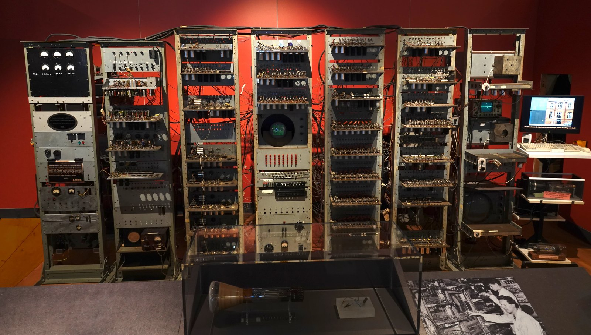
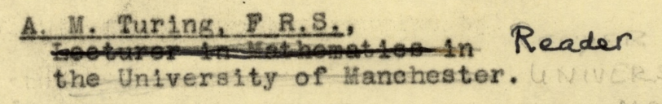
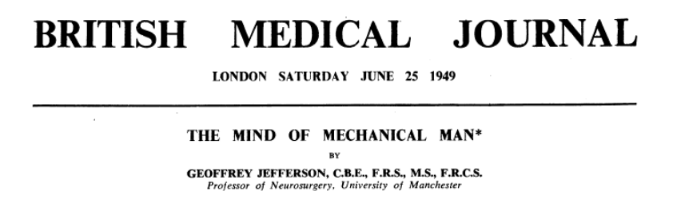
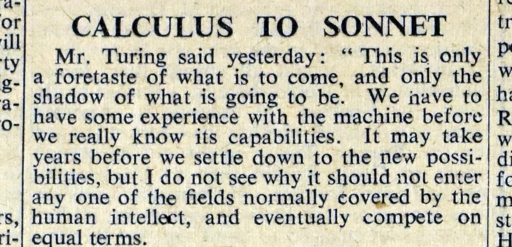
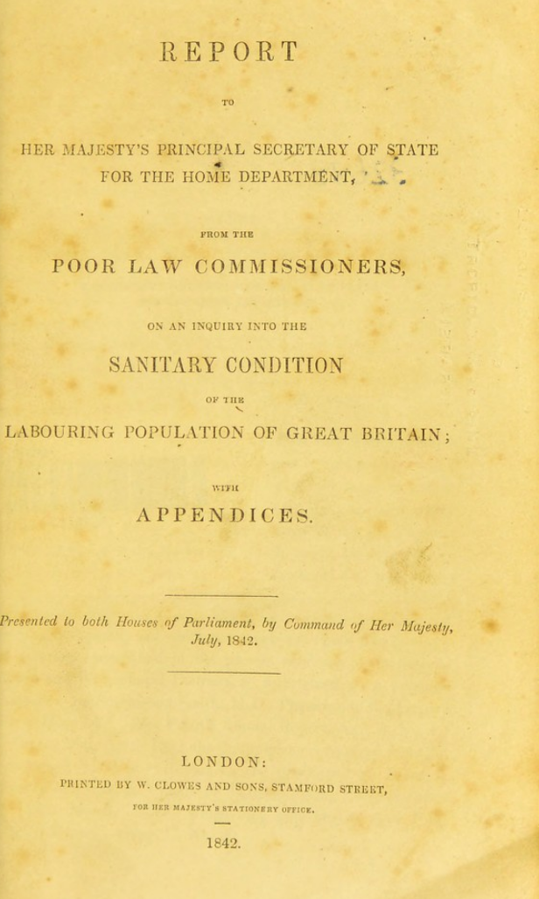
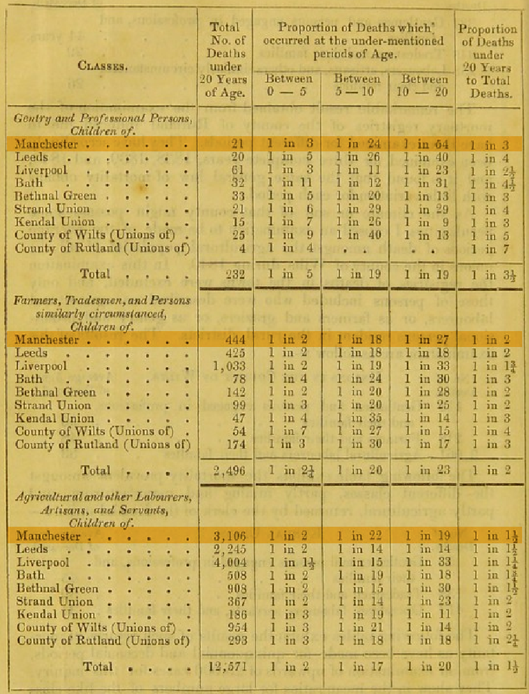
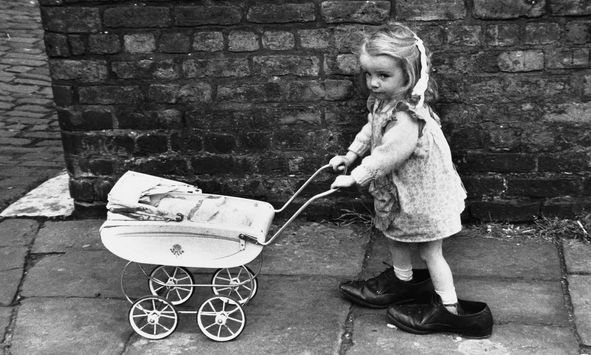
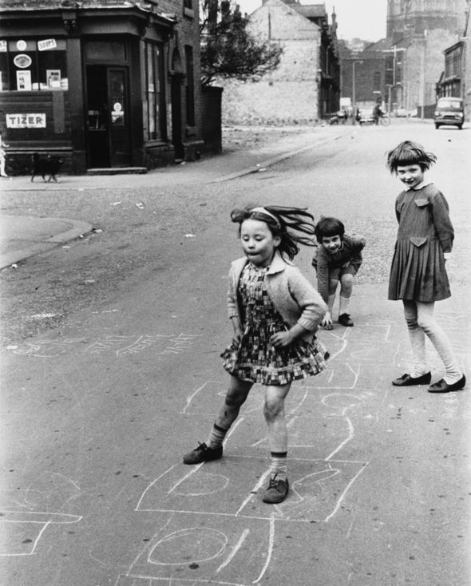
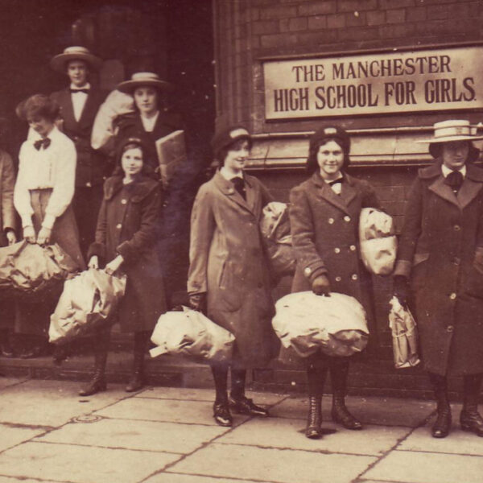

## The Baby {.stage view="1946-1954" grow="machine:1948.6" now="1948-06-21"}

::: {.caption width=640}
**21 June 1948.** In a room on Coupland Street, the Manchester Baby built by Freddie Williams and Tom Kilburn runs the first program ever held in electronic memory. The newspapers call it an "electronic brain".
:::

::: {.plate width=440}

The replica at the Science and Industry Museum, Manchester.
:::

## Turing arrives {.stage grow="machine:1949.3" now="1948-09"}

::: {.caption width=520}
**September 1948.** Alan Turing arrives to programme the machine.
:::

::: {.plate width=560}

:::

## The Lister Oration {.stage grow="machine:1949.44" now="1949-06-09"}

::: {.caption width=560}
**9 June 1949.** Geoffrey Jefferson, Professor of Neurosurgery, gives the Lister Oration at the Royal College of Surgeons.
:::

::: {.plate width=wide}

> "Not until a machine can write a sonnet or compose a concerto because of thoughts and emotions felt, and not by the chance fall of symbols, could we agree that machine equals brain---that is, not only write it but know that it had written it."

[British Medical Journal, 25 June 1949](papers/jefferson-1949-the-mind-of-mechanical-man.pdf)
:::

## Calculus to Sonnet {.stage grow="machine:1949.7" now="1949-06-11"}

::: {.caption width=560}
**11 June 1949.** Alan Turing answers in The Times, under the heading "Calculus to Sonnet".
:::

::: {.plate width=wide}

> "I do not think you can even draw the line about sonnets, though the comparison is perhaps a little bit unfair because a sonnet written by a machine will be better appreciated by another machine."

The Times, Saturday 11 June 1949
:::

## The Ferranti Mark 1 {.stage view="1947.5-1955.5" grow="machine:1951.3" now="1951-02-12"}

::: {.caption width=560}
**February 1951.** Ferranti delivers its Mark 1 to the University, the first general-purpose computer to go on sale.
:::

::: {.plate width=wide}
 

Ferranti's brochure for the machine, June 1952, and its control desk.
:::

## The broadcast {.stage view="1948-1956" grow="machine:1952.2" now="1952-01-10"}

::: {.caption width=wide}
**January 1952.** The BBC puts Jefferson and Turing in a studio with Max Newman and the philosopher Richard Braithwaite, to argue about whether machines can think. The earliest recorded discussion of artificial intelligence we have. The recording is lost but the typescript survives.
:::

## Turing dies {.stage grow="machine:1954.6" now="1954-06-07"}

::: {.caption}
**June 1954.** Turing dies in Wilmslow.
:::

## Jefferson dies {.stage view="1945-1963" grow="machine:1961.3" now="1961-01-29"}

::: {.caption width=wide}
**January 1961.** Jefferson dies, at seventy-four. In a postscript the year before, he had called Turing his most ingenious colleague.
:::

## Maisie is born {.stage view="1946-1961" grow="1949" now="1948-06-21" lit="maisie"}

::: {.caption}
**21 June 1948.** Maisie is born at home in Harpurhey, in a two-up two-down off Rochdale Road.
:::

::: {.plate}

Harpurhey, 1949.
:::

## Before her: Chadwick, 1842 {.stage dim="true" lit="maisie"}

::: {.caption}
**July 1842.** Edwin Chadwick's report on the sanitary condition of the labouring population is presented to Parliament.
:::

::: {.cover}
  

The report's table of deaths under twenty, by class and by town. The Manchester rows are marked.
:::

## 1951: one more child {.stage grow="1955" now="1951" lit="small-family"}

::: {.caption}
**1951.** In one house off Rochdale Road a second child arrives, and that is the family.
:::

::: {.plate}

:::

## 1951: six more {.stage now="1951" lit="large-family"}

::: {.caption}
**1951.** In another, a second arrives, then a third, and by 1960 there are eight of them in the same two rooms.
:::

::: {.plate width=narrow}

:::

## 1960: the question {.stage view="1955-1970" grow="1959.9" now="1960" lit="maisie"}

::: {.caption width=520}
**1960, the eleven-plus.**
:::

::: {.plate width=560}

:::

## 1960: the eleven-plus {.stage grow="1964.8" now="1960" lit="maisie"}

::: {.caption}
**1960, the eleven-plus.** In the small family she passes, and one of her takes the bus to grammar school while the other Maisie walks to the secondary modern.
:::

::: {.plate width=narrow}

:::

## 1965: work {.stage view="1960-1975" grow="1967.9" now="1965" lit="maisie"}

::: {.caption width=760}
**1965, sixteen.** One stays on at school. One goes to the production line at Ferranti in Moston, where the commercial version of the machine upstairs is built. One takes a machinist's job elsewhere.
:::

::: {.plate width=narrow}

:::

## 1965: the bus stop {.stage now="1965" lit="maisie"}

::: {.caption}
**1965.** For the two who go to work, the wait at the bus stop always comes with a cigarette.
:::

::: {.plate}
<video src="images/ferranti-soldering-getty.mp4" poster="images/ferranti-soldering-poster.jpg" data-autoplay loop muted playsinline></video>
:::

## Children {.stage view="1964-1979" grow="1979" lit="maisie"}

::: {.caption}
**Children.** The two who went to work are mothers at twenty.The grammar-school girl, programming the Mark I, instead of soldering it, waits until thirty.
:::

## 1989: a husband's angina {.stage view="1984-1999" grow="1993.5" now="1989" lit="maisie"}

::: {.caption}
**1989.** A husband's angina. One of the smokers stops with him, in solidarity, and because a cardiologist spends five more minutes. 
:::

## 1999: blood pressure {.stage view="1994-2009" grow="2003.5" now="1999" lit="maisie"}

::: {.caption}
**1999.** Blood pressure 165/95, found because of arthritic knee and a general health check.
:::

## 2008: mental capital through life {.stage dim="true" lit="maisie"}

::: {.cover}
<iframe class="mwn-frame" data-src="mwn/index.html?embed=1" data-preload title="Mental capital through life"></iframe>

Mental capital through life. Foresight Mental Capital and Wellbeing Project, Government Office for Science, 2008.
:::

## 2009: hearing {.stage view="2004-2019" grow="2011.8" now="2009" lit="maisie"}

::: {.caption}
**2009.** Hearing aids, or not.
:::

## 2012: the Tuesday club {.stage view="2007-2022" grow="2015.5" now="2012" lit="maisie"}

::: {.caption}
**2012.** The Tuesday club, given up.
:::

## The Centre: evidence and advocacy {.stage view="2014-2021" grow="2020.5" lit="centre"}

::: {.caption}
**The Manchester Brain Health Centre, 2015 to 2019.** Evidence and advocacy: the prevention and biomarker evidence base.
:::

## The Centre: starting from nothing {.stage view="2020.15-2024.15" grow="2024.05" lit="centre"}

::: {.caption}
**2020 to 2023, starting from nothing.** A single-clinician clinic.
:::

## The Centre: partnership and scale {.stage view="2023.6-2027.6" grow="2026.1 centre:2026.9" lit="centre" hold="c-dmt c-blood"}

::: {.caption}
**2024 to 2026, partnership and scale.** A four-way partnership.

[Open marker: planned. Sources: MBHC narrative history (March 2026); Ngandu et al. 2015; Livingston et al. 2017, 2020, 2024; Ritchie et al. 2017; Dunne et al. 2021.]{.source}
:::

## 2026: twelve minutes {.stage view="2015.5-2030.5" grow="2026.9" now="2026.2" lit="maisie"}

::: {.caption}
**2026.** She tells the Ferranti story twice in one afternoon. Her daughter books a GP appointment. Twelve minutes.
:::

## 2027: which clinic {.stage view="2023-2031" grow="2028.2" now="2027" lit="maisie"}

::: {.caption}
**Referred.** To a memory clinic, or to the Brain Health Clinic.
:::

## The memory clinic: come back if it gets worse {.stage view="2025.2-2029.8" grow="2028.97" now="2028.6" lit="matrs"}

::: {.caption}
**The memory clinic.**
:::

## The Brain Health Clinic: a trial, or the NHS {.stage now="2028.6" lit="bhc-trial bhc-nhs"}

::: {.caption}
**The Brain Health Clinic.**
:::

## The Centre: from 2026 {.stage view="2025.2-2028.2" grow="2028.1" lit="centre"}

::: {.caption}
**The Manchester Brain Health Centre, from 2026.**
:::

## Both lines {.stage view="2025.2-2029.8" grow="2028.97" lit="maisie pocket"}

## Sonnet 30 {.sonnet}

::: {.poem}
| [W]{.initial}hen to the sessions of sweet silent thought
| I summon up remembrance of things past,
| I sigh the lack of many a thing I sought,
| And with old woes new wail my dear time’s waste:
| Then can I drown an eye, unused to flow,
| For precious friends hid in death’s dateless night,
| And weep afresh love’s long since cancelled woe,
| And moan th’ expense of many a vanished sight;
| Then can I grieve at grievances foregone,
| And heavily from woe to woe tell o’er
| The sad account of fore-bemoanèd moan,
| Which I new pay as if not paid before.
| [But if the while I think on thee, dear friend,]{.couplet}
| [All losses are restored and sorrows end.]{.couplet}

William Shakespeare, Sonnet 30
:::

## {.end}

[Ross A. Dunne\
Geoffrey Jefferson Brain Research Centre]{.small}
